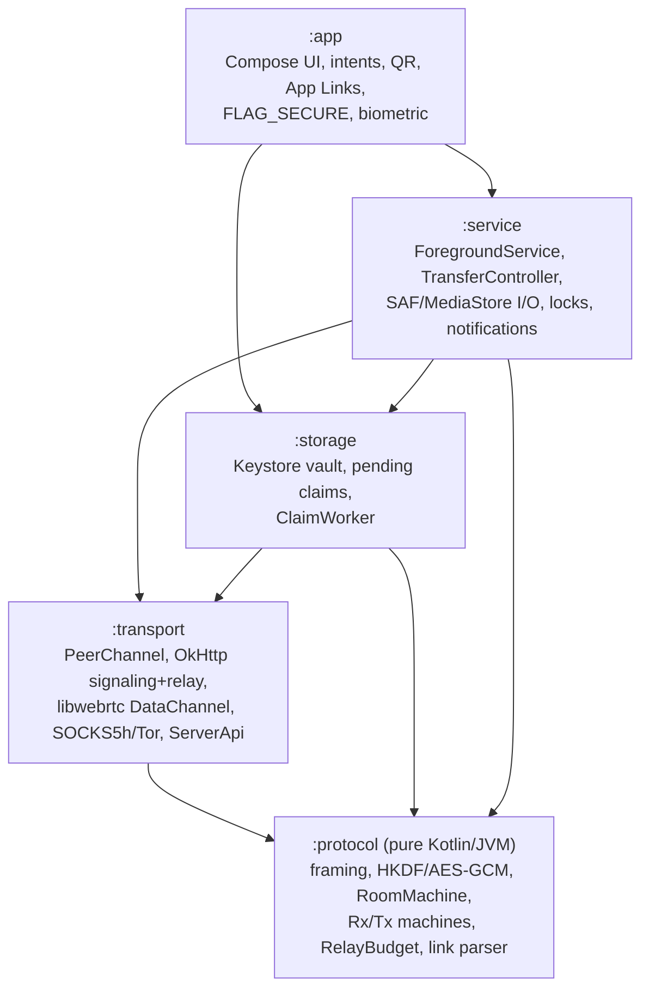
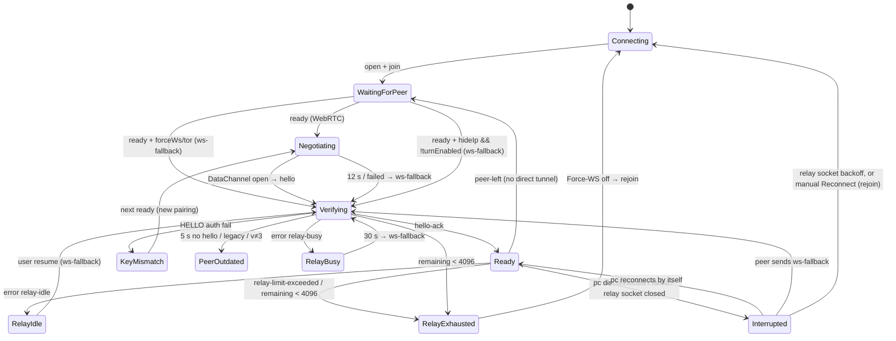

# darkp2p for Android — Technical Design Document

Status: **v1 decisions locked (§8)** · Wire format: **`darkp2p/v3`** · Applies to: `server.js`, `public/index.html` as of commit `d1b9cd7`

This document specifies a native Kotlin Android client that is byte-for-byte and state-for-state compatible with the existing web client and signaling/relay server. Every constant, message and transition below was read from the source, not from the product description. Where the two disagree, the source wins, and the difference is called out in **§0.3**.

Symbol references use the names in the source (grep for them; line numbers drift):
`index.html` → `==BEGIN darkp2p-framing==` block, `handleSignal`, `initPeer`, `sendFile`, `lookupRxKey`, …;
`server.js` → `handleJoin`, `handleControlMessage`, `handleRelayFrame`, `handleClaim`, `handleCheckout`, ….

---

## Contents

0. [Scope, sources and findings that change the brief](#0-scope-sources-and-findings-that-change-the-brief)
1. [Normative wire contract (`darkp2p/v3`)](#1-normative-wire-contract-darkp2pv3)
2. [Module & dependency architecture](#2-module--dependency-architecture)
3. [Core interfaces & state machine](#3-core-interfaces--state-machine)
4. [Byte-level interop & streaming data path](#4-byte-level-interop--streaming-data-path)
5. [Security & leak-prevention checklist](#5-security--leak-prevention-checklist)
6. [Cross-client verification plan](#6-cross-client-verification-plan)
7. [Phased implementation roadmap](#7-phased-implementation-roadmap)
8. [v1 decisions](#8-v1-decisions)

---

## 0. Scope, sources and findings that change the brief

### 0.1 Goals

* A native client that can sit on either side of a room with the current web page, on clearnet or `.onion`, over DataChannel, TURN-only DataChannel, or the WebSocket relay.
* v1 ships with `server.js` untouched. The only server-side item is a static `assetlinks.json`, added at release (§8 D1).
* The Android client's local behaviour may be *stricter* than the page (e.g. capping ICE candidates below the server's limit), never *looser* on the wire.

### 0.2 Non-goals (v1)

* Resumable transfers (the protocol has none; a broken transfer is aborted on both sides).
* More than one concurrent incoming transfer per direction (the page declines a second offer with `busy`).
* ICE restart / renegotiation (the page never does it; see §8).

### 0.3 Findings from the source that refine the brief

| # | Brief says | Source says | Consequence for Android |
|---|---|---|---|
| F1 | "fragment must never be sent to the server" | Correct, and the WS upgrade is also **Origin-checked** (`isOriginAllowed`): `Origin` must be in `ALLOWED_ORIGINS` (`https://${DOMAIN}`, plus `http://${ONION_HOST}`) or match `Host`. A missing Origin → **HTTP 403**. | OkHttp must send `Origin: https://darkp2p.com` (clearnet) or `Origin: http://<onion>` (onion). 403 is a terminal config error, not a retry. |
| F2 | "50 MB free / 500 MB Pro" | Server sends the live figures in `ready.wsRelayCap` / `ready.wsRelayRemaining`; the room budget persists while either peer stays in the room and counts **both directions, every binary frame, header included**. | `RelayBudget` is seeded from `ready`, never from constants (constants are the fallback for an old server only, exactly as `setRelayBudgetFrom`). |
| F3 | "Pro tokens unlock coturn" | TURN is in `ready.iceServers` only when `room.isPro && TURN_ENABLED` (`turnEnabled`, alias `relayEnabled`). Hide-IP **without** TURN is refused by the page (`PRO TOKEN REQUIRED TO HIDE IP`). | Hide-IP uses TURN when `turnEnabled == true`; otherwise Android falls back to the **WS relay** (which also masks the IP) with an inline note that Pro unlocks TURN (no relay cap) and the 500 MB relay (§8 D3). On the wire this is an ordinary `ws-fallback`. |
| F4 | WorkManager "max every 5 min" | `PeriodicWorkRequest` has a **15-minute floor**. | Background polling uses a chain of `OneTimeWorkRequest`s with `setInitialDelay(≥5 min)`; foreground polling mirrors the page's 3 s→30 s schedule (§3.6). |
| F5 | "`/api/claim` requires orderId + paymentId/invoiceId" | An **invoiceId** claim is answered only from the IPN record in server RAM (lost on restart); only a **paymentId** claim can be re-derived from NOWPayments. `success_url` is `https://${DOMAIN}/` (no app return). | v1 polls with `{invoiceId, orderId}` and offers a manual "paste payment ID" field; the existing `?NP_id=` redirect is captured automatically once verified App Links exist at release (§8 D1, D2). |
| F6 | `TRANSFER_KEY_CACHE_MAX` | `= 8`, LRU keyed by `hex(transferId)`, **per session** (re-created whenever both nonces change). | Mirrored exactly; key cache dies with the session. |
| F7 | Reconnect backoff reset "after a stable window" | `RECONNECT_STABLE_MS = 10 000`, timer starts **after** the claim wait (≤ `CLAIM_JOIN_WAIT_MS` = 5 s) on `onopen`. | Same; reset only from the stable timer, never from `onopen`. |
| F8 | — | OkHttp `WebSocket.send()` **gracefully closes the socket** if its queue would exceed 16 MiB. | All relay sends are gated on `queueSize() ≤ HIGH_WATER` (1 MiB) — mandatory, not an optimisation. |
| F9 | — | The server **pauses reading** a relay sender for throttling (token bucket) and backpressure, up to `RELAY_STALL_MS` = 60 s. A client-side WS ping issued during a pause gets no pong. | OkHttp `pingInterval` must be **≥ 90 s** (we use 90 s). A 15–30 s ping interval kills legitimate relay transfers. |
| F10 | — | Server closes a socket after **200 ICE candidates per pairing** (`too-many-candidates`) and after **120 JSON messages / 10 s**. | `GATHER_ONCE`, client-side cap of 150 candidates, never `GATHER_CONTINUALLY`. |
| F11 | — | `ack` messages must **not** carry `"done": false`: `TxWindow.onReply` rejects any `done` that is not exactly `true` or absent. | `Ctrl.ack()` writes `done` only for the final ack; the page's own `TxWindow` checks this in `npm test`. |
| F12 | — | Native libwebrtc does **not** obfuscate host candidates with mDNS (Chrome does). | Direct mode **signals host candidates** (fast LAN transfers) and shows `IP EXPOSED`. The Java API has no clean mDNS obfuscation, so none is used in v1. **Hide My IP** is the single switch that hides local and public addresses (§8 D6). |

---

## 1. Normative wire contract (`darkp2p/v3`)

This section is the contract the `:protocol` module implements and the test vectors (§6) pin.

### 1.1 Room link

```
<origin>/#<roomId>:<keyB64u>
origin  = https://darkp2p.com  | http://<56 base32>.onion | self-hosted origin
roomId  = /^[a-f0-9]{16,64}$/i      (generated: 16 random bytes → 32 lowercase hex)
keyB64u = Base64URL, no padding, length ≥ 43, decodes to exactly 32 bytes
```

Parsing (`initRoomAndKey`): split the fragment on `:`; **exactly two** parts; regex on part 0; part 1 length ≥ 43 and decodes to 32 bytes, else generate a new room. Path is `/`; the query string is never part of a share link (it may carry `?NP_id=`). The server lower-cases `roomId`; the client sends it as parsed.

The **origin of the link selects the server** — rooms exist per server. An onion origin forces Tor mode (§1.8).

### 1.2 Key schedule

| Key | Construction | Output |
|---|---|---|
| Room key | 32 random bytes from the link | IKM only |
| HELLO key | `HKDF-SHA256(IKM = roomKey, salt = transferId[16], info = "darkp2p/v3/hello")` | 32 B AES-256-GCM key |
| Transfer key | `HKDF-SHA256(IKM = roomKey, salt = transferId[16] ‖ initNonce[32] ‖ respNonce[32], info = "darkp2p/v3/transfer")` | 32 B AES-256-GCM key |

`initNonce` is the **initiator's** hello nonce, regardless of who computes it. Web Crypto's `deriveKey(HKDF → AES-GCM 256)` is RFC 5869 extract-then-expand with `L = 32`; the Kotlin implementation is plain RFC 5869 over `javax.crypto.Mac("HmacSHA256")`.

### 1.3 Frame layout

```
offset  len  field
0       1    type        0x20 HELLO | 0x21 CTRL | 0x22 DATA
                         legacy 0x01 0x02 0x11 0x12 → peer is "outdated"
1       16   transferId
17      4    seq         uint32, big-endian
21      12   iv          random per frame
33      n+16 ciphertext ‖ GCM tag (128-bit)
-------------------------------------------
FRAME_HEADER_LEN = 33, FRAME_OVERHEAD = 49, min frame = 49 bytes
```

AAD (25 bytes): `"DP3"(0x44 0x50 0x33) ‖ type ‖ senderRole ‖ transferId ‖ seq(BE u32)` where `senderRole` is `0x01` initiator / `0x02` responder. The receiver decodes with the **peer's** role, which defeats reflection.

### 1.4 Session handshake

On every transport open (DataChannel `open`, or WS relay activation) each side:

1. draws a fresh 32-byte nonce, sends **HELLO** (`type 0x20`, fresh random transferId, `seq 0`, HELLO key) with payload
   `{"type":"hello","v":3,"nonce":"<b64u 32 B>"}`;
2. on the peer's hello: `v !== 3` → **PeerOutdated**; nonce ≠ 32 B → integrity error; same nonce as before → ignore; otherwise store, drop the old session, end transfers;
3. once both nonces are known, builds the transfer-key LRU and sends **hello-ack** (`CTRL`, fresh transferId, `seq 0`, transfer key) `{"type":"hello-ack","v":3}`;
4. on decrypting the peer's hello-ack while `pending` → **`ok`** (file actions enabled).

Failure rules (`handleIncomingFrame`, `armHelloTimer`):

* a HELLO that fails GCM auth → **KeyMismatch** (sticky until the next pairing);
* a session frame that fails auth before `ok` → silently ignored (a superseded hello-ack);
* legacy frame type → **PeerOutdated**;
* 5 s (`HELLO_TIMEOUT_MS`) with no peer hello → **PeerOutdated**; with a peer hello but no hello-ack → "session unconfirmed" warning, stay `pending`.

### 1.5 Transfer protocol

Forward frames (sender's role) on one `transferId`:

| seq | frame | payload |
|---|---|---|
| 0 | CTRL | `{"type":"meta","name":s,"size":u53,"mime":s,"chunks":u32}` |
| 1…N | DATA | raw bytes, 1…`CHUNK_SIZE` (16 000) |
| N+1 | CTRL | `{"type":"done","chunks":N,"size":size}` |
| last+1 | CTRL | `{"type":"abort","reason":"user\|integrity\|disk\|timeout"}` |

Replies (receiver's role, **same transferId**, seq 1, 2, 3, …): `accept`, `decline{reason: user|size|busy}`, `ack{seq}` every `ACK_EVERY` = 64 chunks (when `chunks % 64 == 0`), the final `ack{seq:N, done:true}`, then `complete`, or `abort{reason}` at any active point.

Validation (`RxStateMachine.parseMeta`): `size` safe integer ≥ 0; `chunks` safe integer, `size == 0 ⇒ chunks == 0`, else `1 ≤ chunks ≤ size`, `chunks ≤ 0xFFFFFFFF − 2`; `name = String(name || "download.bin").replace(/[\\/]/g, "_")`; `mime` defaults to `application/octet-stream`. Out-of-order seq, extra chunk, empty chunk, overflow of `size`, mismatched `done` → `abort{integrity}`.

Flow control and timers: `TX_WINDOW` = 256 unacked chunks; receiver aborts if more than `RX_MAX_PENDING_CHUNKS` = 256 DATA or `RX_MAX_PENDING_CTRL` = 32 CTRL frames are queued; `ACCEPT_TIMEOUT_MS` = 5 min, `ACK_STALL_MS` = 60 s (only while the window is full), `COMPLETE_TIMEOUT_MS` = 5 min (→ `unconfirmed`, a neutral end, if `done` was acked). Watchdog tick 1 s.

Replay/reorder guards (`lookupRxKey`): HELLO only with `seq 0` and an unseen transferId; DATA or `seq ≠ 0` only for the active rx (or CTRL replies for the active tx) and only when `handshake == ok`; `seq 0` CTRL only with an unseen transferId; ended transfers' late frames dropped quietly. `SEEN_TRANSFER_IDS_MAX` = 64, `ENDED_TRANSFER_IDS_MAX` = 16, both FIFO-evicted.

A second `meta` while receiving → `decline{busy}` at seq 1 without creating state; a malformed `meta` → `abort{integrity}` at seq 1.

### 1.6 Signaling messages (JSON text frames)

Client → server:

```jsonc
{"type":"join","room":"<hex>","token":"<exp>.<64 hex> | \"\""}
{"type":"offer","offer":{"type":"offer","sdp":"..."}}
{"type":"answer","answer":{"type":"answer","sdp":"..."}}
{"type":"candidate","candidate":{"candidate":"...","sdpMid":"0","sdpMLineIndex":0,"usernameFragment":"..."}}
{"type":"ws-fallback"}
```

Server → client (`handleJoin`, `notifyRelayLimit`, `leaveRoom`, timers):

```jsonc
{"type":"ready","initiator":bool,"iceServers":[...],"turnEnabled":bool,"relayEnabled":bool,
 "wsRelayCap":int,"wsRelayRemaining":int}
{"type":"full"}
{"type":"peer-left"}
{"type":"error","reason":"invalid-room|relay-limit-exceeded|relay-busy|relay-idle|relay-stalled"}
// plus the peer's offer / answer / candidate / ws-fallback, rebuilt field-by-field by sanitizeSignal
```

Binary WS frames are relayed only when the room has two peers **and** `relayActive`; otherwise they count as control messages. `ws-fallback` sets `relayActive` (unless the budget is < `RELAY_MIN_REMAINING` = 4096 → `relay-limit-exceeded`, or `MAX_RELAY_ROOMS` is reached → `relay-busy` **to the requester only**, not forwarded).

Upgrade/close semantics: path `/`; 403 bad Origin; 429 rate limit (6 concurrent / 20 per minute per IP or /64; onion shares 100 concurrent / **120 per minute** for *all* onion users). Close 1008 with reason `Message rate limit exceeded`, `too-many-candidates`, `relay-limit-exceeded` (8 MiB over cap), `relay-stalled`; 1001 on shutdown. Server heartbeat: ping every 30 s, terminate after one missed pong (skipped while paused). `maxPayload` = 64 KiB.

### 1.7 Relay budget arithmetic (`RelayBudget`)

```
wireBytes(size, chunk=16000) = size + chunks·49 + acks·(49+32) + RELAY_CTRL_RESERVE(1024)
  chunks = ceil(size / chunk),  acks = ceil(chunks / 64) + 1
fits(size) ⇔ wireBytes(size) ≤ remaining
charge(n)  : remaining = max(0, remaining − n) for every binary frame sent or received on the relay
```

### 1.8 Transport modes and their selection (from `initPeer`, `activateWsFallback`)

| Mode | Trigger | RTCConfiguration | Fallback |
|---|---|---|---|
| Direct P2P | default | `iceServers` from `ready`, policy `all` | before the tunnel opens: 12 s ICE timer or `failed` → `ws-fallback`. After it was up, Android goes to `Interrupted` (§8 D5); the page falls back automatically |
| Hide My IP (TURN) | toggle on **and** `turnEnabled` | policy `relay` | same |
| Hide My IP (relay) | toggle on, no `turnEnabled` (Android only; the page blocks instead) | none | — |
| WS relay | Force-WS toggle, no WebRTC, timeout/failure, **or Tor mode** | none (PeerConnection never created) | — |

Toggling Force-WS **off** while on the relay → `rejoinRoom()`: close the signaling socket, reconnect (backoff applies), new `ready` → fresh pairing → WebRTC attempt. Toggling it **on** with a PeerConnection → `activateWsFallback(true)`.

### 1.9 Pro token & payments

* Token: `"<expUnix>.<hex HMAC-SHA256>"`, ≤ 128 chars. The client can read `exp` for display but cannot verify it.
* `POST /api/checkout` `Content-Type: application/json` (exactly), body `{"tier":"pro-1d"|"pro-30d"}`, ≤ 4 KiB → `200 {invoiceUrl, invoiceId|null, orderId}`; 429 (`Retry-After: 60`), 503 (`Retry-After`), 502, 404 (disabled).
* `GET /api/claim?paymentId=…&orderId=…` (or `invoiceId=`) → `200 {ready:true, token}` | `200 {ready:false, status:"partially_paid"}` | 404 (not yet / unknown) | 429/503 with `Retry-After`.
* `orderId` = `/^(pro-1d|pro-30d):[a-f0-9]{32}$/` is the claim secret; IDs `/^[1-9][0-9]{0,19}$/`.
* Page poll schedule (`pollClaim`): first try 3 s, doubling to 30 s (with paymentId) or 5 min (invoice-only), honour `Retry-After` ≤ 10 min, each poll run ≤ 6 h, claim discarded 48 h after `startedAt`.

### 1.10 Chat (Android ↔ Android extension)

Not part of the page's protocol, and built so the page never sees any of it.

**Offer.** The app's hello carries one more field: `{"type":"hello","v":3,"nonce":"…","caps":["chat"]}`. The page's `acceptHello` reads only `v` and `nonce`, so to the page this is an ordinary v3 hello (`test/caps.test.mjs` runs the real page against such a peer). The page's own hello has no `caps`. Chat is on only when **both** hellos of the current session list `"chat"`; with a web peer it is off, the chat box stays hidden, and no chat frame is ever sent. Unknown names in `caps` are ignored, and anything but a list of strings offers nothing.

**Why it must never reach the page.** The page has no `chat` message: it answers one with `Unexpected control frame`, and if it is receiving a file at that moment it aborts that file. The gate is therefore in the state machine (`chatEnabled()`), not in the UI.

**Frames.** Each side has one chat stream per session: a random 16-byte transfer ID with CTRL frames numbered 0, 1, 2, … under the session's transfer key (so chat is bound to both hello nonces like everything else). A frame is one of:

```jsonc
{"type":"chat","text":"…"}        // 1…8192 UTF-8 bytes
{"type":"chat-ack","seq":n}       // receipt for the chat message in frame n of the OTHER side's stream
```

**Rules.**
* The receiver accepts only the next frame number of the one stream the peer opened in this session. A replayed, reordered or forged frame is refused; if the relay drops a message, the stream stops instead of showing later messages out of sequence. A refused chat frame never ends a file transfer.
* At most 8 messages may await their receipt (`ChatConstants.WINDOW`). The receiver holds at most 32 control frames while a chunk is written, so chat cannot overflow that queue during a transfer.
* On the WebSocket relay every chat frame and receipt counts against the room budget like any binary frame. A message is refused locally when it would leave less than `RELAY_MIN_REMAINING` (4096 bytes), so chat cannot exhaust the room.
* A new session (new hello on either side, relay pause/resume, reconnect) starts new streams. Messages still awaiting a receipt are reported as `SESSION_ENDED`: they may or may not have been read.
* No timestamps, names or read receipts are sent. The text is never put in a log line, notice or `toString()`.

---

## 2. Module & dependency architecture

### 2.1 Module graph



ASCII equivalent:

```
 :app ──► :service ──► :transport ──► :protocol
   │         │             ▲              ▲
   └──► :storage ──────────┘──────────────┘
```

Rules, enforced by `./gradlew checkStructure` (part of `check`) in CI:

* `:protocol` is `kotlin("jvm")` with **zero** Android imports (`checkProtocolPurity`). It has no runtime dependency beyond `kotlin-stdlib`.
* `:transport` exposes interfaces + factories; libwebrtc types never leak past it (`api` vs `implementation`).
* `:storage` depends on `:transport` only for `ServerApi` (the Tor-aware HTTP client) — it never touches WebRTC.
* Test-only modules (not shipped): `:interop-cli` (JVM; §6.3) and `:testing` (fakes: `FakePeerChannel`, `FakeClock`, deterministic RNG).

### 2.2 Platform & toolchain

| Item | Choice | Rationale |
|---|---|---|
| `minSdk` | **29** (Android 10) | Scoped storage + `MediaStore.Downloads` + `IS_PENDING`; OpenJDK-based `libcore`; TLS 1.3 by default. |
| `targetSdk` / `compileSdk` | **37** | Newest released level (Lint rejects an older `compileSdk`); exercises Android 15 `dataSync` FGS timeout and Android 14 FGS-type rules. |
| JDK / AGP / Gradle | Java 17 bytecode, built with JDK 21 in CI; AGP 9.5.3 (built-in Kotlin); Gradle 9.9.2 wrapper with `distributionSha256Sum` | Reproducibility (§5.7). |
| Kotlin | 2.4.21, explicit API mode in every library module, warnings as errors in `:protocol` | |
| Coroutines | `kotlinx-coroutines` 1.11.0 | Single-threaded engine via `limitedParallelism(1)`. |
| JSON | In-house strict parser and serializer in `:protocol` (`Json.kt`), vector-tested | F11; the same accept/reject decisions as `JSON.parse`, the same text as `JSON.stringify`. |
| HTTP/WS | **OkHttp 5.5.1** | Custom `Dns`, `SocketFactory`, Origin header, `queueSize()`. |
| WebRTC | `io.github.webrtc-sdk:android` 150.7871.09 (community-maintained Google libwebrtc build), `full` flavor only; host-JVM tests use `dev.onvoid.webrtc:webrtc-java` 1.0.1, never shipped; `libre` flavor: same tag built from source (§5.7) | `org.webrtc:google-webrtc` is unmaintained since 2020. Only `DataChannel` is used; no audio/video tracks. |
| Crypto | JCA `AES/GCM/NoPadding` (Conscrypt/BoringSSL on device, SunJCE in JVM tests) + in-house RFC 5869 HKDF (~30 lines, vector-tested) | No BouncyCastle/Tink needed in `:protocol`; identical code on JVM and device. |
| Keystore | Android Keystore AES-256-GCM key, StrongBox when available | Vault encryption (§3.6). Jetpack `security-crypto` is deprecated — not used. |
| Persistence | `AtomicFile` blob (vault) — no SQLite | Two small records only. |
| Background | WorkManager 2.12.0 | Claim polling. |
| UI | Jetpack Compose (BOM pinned), Material 3, Navigation-Compose | |
| QR | **ZXing `core` 3.5.4** (generate + decode) + **CameraX 1.7.0** `ImageAnalysis` | FOSS; ML Kit is proprietary and rejected by F-Droid. |
| Checkout | `androidx.browser` Custom Tabs (clearnet only) | §3.6, §5.3. |
| Tor | Orbot via its public intents (default) or embedded `info.guardianproject:tor-android` + `jtorctl` (`full` flavor) | §4.6. |
| Biometrics | `androidx.biometric` (`BIOMETRIC_STRONG or DEVICE_CREDENTIAL`) | |
| Coverage | Kover 0.9.11 on `:protocol`, 90 % line minimum in `check` | |
| Static analysis | `checkStructure` (source-scanning Gradle tasks in `android/build.gradle.kts`: module graph, `:protocol` purity, forbidden APIs, pinned versions) and Android Lint `warningsAsErrors`. No extra analysis plugin: the checks needed are simple patterns, and each plugin is more supply chain | |

Build flavors: `full` (GitHub/Play: prebuilt libwebrtc AAR, embedded Tor option) and `libre` (F-Droid: from-source libwebrtc, Orbot only, no `autoVerify` App Links — §5.4).

---

## 3. Core interfaces & state machine

### 3.1 Concurrency model (why it is safe to port line-by-line)

The page relies on the JS event loop plus three ordered promise chains:

* `sigQueue` — inbound signaling messages are handled strictly in order, including async ones (`ready → initPeer`, `offer → createAnswer`);
* `rxQueue` — inbound frames are decoded/processed strictly in order;
* `outQueue` — outbound frames are encrypted and sent strictly in seq order, with the session keys captured **at enqueue time**.

Android reproduces this with:

1. **One engine dispatcher** (`Dispatchers.Default.limitedParallelism(1)`) that owns all mutable protocol state (`RoomMachine`). Every callback (OkHttp reader thread, libwebrtc signaling thread, I/O completions, timers, UI intents) is converted into an `EngineInput` and posted to it. Nothing else mutates state.
2. **One outbound queue** per channel (`Channel<OutFrame>(capacity = 64)`) drained by a single coroutine that does `awaitWritable() → trySend()`. Frames are encrypted on the engine dispatcher *before* enqueueing, which gives the same "keys captured at queue time" property as `sendCtrl(..., keys = session.keys)`.
3. **One inbound queue** (`Channel<InFrame>` with separate DATA/CTRL counters capped at 256/32, `trySend` only). Overflow ⇒ one `abort{integrity}`, exactly as `enqueueIncomingBinary`.

> **Implemented (Phase 1).** §3.2–3.4 are built in `android/protocol`, and the code is now authoritative for exact signatures. The listings below are the design sketch; the implementation differs in these ways:
> - The reducer's types are `RoomInput` / `RoomEffect` (not `EngineInput` / `Effect`). Sockets, WebRTC sessions and transfers are identified by small integers the machine allocates, and inputs for a stale one are ignored.
> - `seq` is a `Long` (0…2³²−1) and frame types/roles are enums with a `wire` value, not value classes.
> - `:protocol` has **no dependencies at all**: JSON is read by its own strict RFC 8259 parser (`Json.kt`), because a general-purpose library does not promise the same accept/reject decisions as the page's `JSON.parse`.
> - `Ctrl` decoding maps everything the page would refuse to values the state machines refuse (`Ctrl.Unknown`, `Ack.valid == false`), not to exceptions.
> - Backpressure: the machine issues one `ReadChunk` at a time and waits for `FrameSent` (the frame left the local send buffer) before the next. Inbound frames wait inside the machine while a write is pending, which is where the 256/32 queue caps are enforced.
> - Before accepting, the host opens the destination itself; the effects are `WriteChunk`, `CommitSink` and `DiscardSink` (no `OpenSink`).
> - `RoomState.Ready` carries `relayCap`/`relayRemaining` directly; there is no `ProRequiredForHideIp` or `SetForceWs` (one `SetPolicy` input carries all three switches).

### 3.2 `:protocol` — framing & crypto

```kotlin
public enum class FrameType(public val wire: Byte) { HELLO(0x20), CTRL(0x21), DATA(0x22);
  public companion object { public val LEGACY: Set<Byte> = setOf(0x01, 0x02, 0x11, 0x12) } }

public enum class Role(public val wire: Byte) { INITIATOR(0x01), RESPONDER(0x02);
  public val peer: Role get() = if (this == INITIATOR) RESPONDER else INITIATOR }

@JvmInline public value class TransferId(private val bytes: ByteArray) { /* 16 B, constant-time equals, hex */ }
@JvmInline public value class Seq(public val value: UInt)
public class RoomKey private constructor(private val ikm: ByteArray) : AutoCloseable { /* 32 B; close() zero-fills */ }
public class SessionNonces(public val init: ByteArray, public val resp: ByteArray)   // 32 B each

public interface Hkdf { public fun sha256(ikm: ByteArray, salt: ByteArray, info: ByteArray, length: Int): ByteArray }

public interface FrameCrypto {
  public fun helloKey(room: RoomKey, id: TransferId): AeadKey
  public fun transferKey(room: RoomKey, id: TransferId, nonces: SessionNonces): AeadKey
}

public class TransferKeyCache(room: RoomKey, nonces: SessionNonces, max: Int = 8, crypto: FrameCrypto) {
  public operator fun get(id: TransferId): AeadKey          // LRU: hit moves to MRU; evicts LRU above max
}

public data class DecodedFrame(val type: FrameType, val transferId: TransferId, val seq: Seq, val payload: ByteArray)

public sealed class FrameError(msg: String) : Exception(msg) {
  public class Malformed(msg: String) : FrameError(msg)   // 'malformed'
  public class Legacy : FrameError("Legacy (v1/v2) frame") // 'legacy'
  public class Auth : FrameError("Frame authentication failed")
  public class Rejected(msg: String) : FrameError(msg)    // refused before decryption
  public class Stale : FrameError("No session yet")
  public class Dropped : FrameError("Frame of an ended transfer")
}

public object FrameCodec {
  public const val HEADER_LEN: Int = 33; public const val OVERHEAD: Int = 49
  public fun encode(type: FrameType, role: Role, id: TransferId, seq: Seq,
                    payload: ByteArray, key: AeadKey, iv: ByteArray /* 12 B, from SecureRandom */): ByteArray
  /** keyLookup runs BEFORE decryption and may throw Rejected/Stale/Dropped. */
  public fun decode(bytes: ByteArray, peerRole: Role,
                    keyLookup: (TransferId, FrameType, Seq) -> AeadKey): DecodedFrame
  public fun aad(type: FrameType, senderRole: Role, id: TransferId, seq: Seq): ByteArray // 25 B
}
```

The `iv` parameter exists so test vectors can be deterministic; production always passes `SecureRandom` output.

### 3.3 `:protocol` — control messages, Rx/Tx machines, budget, link

```kotlin
@Serializable public sealed interface Ctrl {
  @Serializable @SerialName("hello")     public data class Hello(val v: Int, val nonce: String) : Ctrl
  @Serializable @SerialName("hello-ack") public data class HelloAck(val v: Int) : Ctrl
  @Serializable @SerialName("meta")      public data class Meta(val name: String, val size: Long, val mime: String, val chunks: Long) : Ctrl
  @Serializable @SerialName("done")      public data class Done(val chunks: Long, val size: Long) : Ctrl
  @Serializable @SerialName("accept")    public data object Accept : Ctrl
  @Serializable @SerialName("decline")   public data class Decline(val reason: String) : Ctrl
  @Serializable @SerialName("ack")       public data class Ack(val seq: Long, val done: Boolean? = null) : Ctrl
  @Serializable @SerialName("complete")  public data object Complete : Ctrl
  @Serializable @SerialName("abort")     public data class Abort(val reason: String) : Ctrl
}
/** Lenient decoder that mirrors JS semantics: numbers must be safe integers (3.0 == 3),
 *  meta.name falls back like String(name || 'download.bin'), unknown keys ignored. */
public object CtrlCodec { public fun decode(payload: ByteArray): Ctrl; public fun encode(c: Ctrl): ByteArray }

public class ProtocolError(public val reason: AbortReason, msg: String) : Exception(msg)
public enum class AbortReason(public val wire: String) { USER("user"), INTEGRITY("integrity"), DISK("disk"), TIMEOUT("timeout") }
public enum class DeclineReason(public val wire: String) { USER("user"), SIZE("size"), BUSY("busy") }

public class RxStateMachine(public val meta: ValidMeta) {          // port of RxStateMachine
  public enum class Phase { OFFERED, RECEIVING, VERIFYING, COMPLETE, DECLINED, ABORTED }
  public val phase: Phase; public val bytes: Long; public val chunks: Long
  public fun accept(); public fun decline()
  public fun onData(seq: Seq, length: Int): Long?                 // ack seq or null
  public fun onDone(seq: Seq, done: Ctrl.Done): Long              // final ack seq
  public fun complete(); public fun onAbort(seq: Seq); public fun abort(): Boolean
  public fun nextReplySeq(): Seq
  public companion object { public fun parseMeta(m: Ctrl.Meta): ValidMeta }
}

public class TxWindow(chunks: Long, now: Long, window: Int = 256, /* timeouts */) {  // port of TxWindow
  public enum class Phase { OFFERED, SENDING, AWAITING_COMPLETE, DELIVERED, UNCONFIRMED, DECLINED, ABORTED }
  public fun canSendData(): Boolean; public fun nextDataSeq(now: Long): Seq; public fun doneSeq(now: Long): Seq
  public fun abortSeq(reason: AbortReason): Seq?; public fun onReply(seq: Seq, msg: Ctrl, now: Long): ReplyKind
  public fun timedOut(now: Long): TxTimeout?; public fun endUnconfirmed(): Boolean
}

public class RelayBudget(public val cap: Long, remaining: Long) {
  public var remaining: Long; private set
  public fun charge(frameBytes: Int)
  public fun fits(size: Long, chunkSize: Int = CHUNK_SIZE): Boolean
  public val belowHandshakeMinimum: Boolean get() = remaining < RELAY_MIN_REMAINING  // 4096
  public companion object { public fun wireBytes(size: Long, chunkSize: Int): Long }
}

public object Backoff { public fun reconnectDelay(attempt: Int, rand: Double): Long }  // 1 s·2^min(n,16) ≤ 30 s, ±20 %, Math.round

public data class RoomLink(val origin: ServerOrigin, val roomId: String, val key: RoomKey) {
  public fun shareUrl(): String                              // "<origin>/#<roomId>:<b64u>", never the query
  public companion object { public fun parse(url: String): RoomLink?; public fun generate(origin: ServerOrigin, rng: SecureRandom): RoomLink }
}

public object CandidatePolicy {                             // port of candidateExposesIp + Android rules
  public fun exposesIp(line: String): Boolean
  public fun decide(line: String, mode: IceMode): CandidateDecision   // ALL: signal; RELAY: relay-only, raddr blanked
}
```

### 3.4 `:protocol` — `RoomMachine` (the engine core) and `RoomState`

The engine is a **pure reducer**: no clocks, threads, sockets or files. It is a direct structural port of the page's module-level variables and handlers, which makes the state machine auditable against the JS and replayable from traces (§6.2).

```kotlin
public class RoomMachine(
  private val key: RoomKey,
  private val clock: () -> Long,
  private val rng: SecureRandom,
  private val crypto: FrameCrypto,
  private val policy: LocalPolicy,               // forceWs, hideIp, torMode
) {
  public val snapshot: EngineState
  public fun handle(input: EngineInput): List<Effect>
}

public sealed interface EngineInput {
  // signaling
  public data class SignalingOpened(val socket: SocketId) : EngineInput
  public data class SignalingStable(val socket: SocketId) : EngineInput                // 10 s timer fired
  public data class SignalingClosed(val socket: SocketId, val cause: CloseCause) : EngineInput
  public data class Server(val socket: SocketId, val msg: ServerMessage) : EngineInput
  // transports
  public data class Frame(val via: ChannelKind, val bytes: ByteArray) : EngineInput    // engine charges RelayBudget first (WS)
  public data class DataChannelOpened(val channel: ChannelId) : EngineInput
  public data class DataChannelClosed(val channel: ChannelId) : EngineInput
  public data class PcState(val state: PeerConnectionState) : EngineInput
  public data class LocalSdp(val kind: SdpKind, val sdp: String) : EngineInput
  public data class LocalCandidate(val c: SignalCandidate) : EngineInput
  public data class WebRtcFailed(val step: String) : EngineInput
  // timers
  public data class TimerFired(val id: TimerId) : EngineInput   // HELLO, ICE(12 s), RELAY_BUSY(30 s), TX_WATCHDOG(1 s), RECONNECT
  // user
  public data class SendFile(val source: SourceDescriptor) : EngineInput   // name,size,mime — no bytes
  public data class AcceptIncoming(val sinkReady: Boolean) : EngineInput
  public data object DeclineIncoming : EngineInput
  public data object CancelSend : EngineInput
  public data object CancelReceive : EngineInput
  public data class SetForceWs(val on: Boolean) : EngineInput
  public data object ResumeRelay : EngineInput
  public data object Reconnect : EngineInput                    // manual clean rejoin from Interrupted
  public data class TokenChanged(val token: String?) : EngineInput
  // I/O completions (from TransferController)
  public data class ChunkReady(val id: TransferId, val index: Long, val bytes: ByteArray) : EngineInput
  public data class ChunkPersisted(val id: TransferId, val seq: Seq) : EngineInput
  public data class SinkCommitted(val id: TransferId) : EngineInput
  public data class IoFailed(val id: TransferId, val reason: AbortReason, val detail: String) : EngineInput
}

public sealed interface Effect {
  public data class Connect(val delayMs: Long) : Effect
  public data class CloseSignaling(val rejoin: Boolean) : Effect
  public data class SendSignal(val msg: ClientMessage) : Effect
  public data class SendFrame(val via: ChannelKind, val bytes: ByteArray) : Effect   // ordered
  public data class StartWebRtc(val initiator: Boolean, val ice: IceConfig, val mode: IceMode) : Effect
  public data class ApplyRemote(val kind: SdpKind, val sdp: String) : Effect
  public data class AddRemoteCandidate(val c: SignalCandidate) : Effect
  public data object CloseWebRtc : Effect
  public data class ArmTimer(val id: TimerId, val delayMs: Long) : Effect
  public data class CancelTimer(val id: TimerId) : Effect
  public data class ReadChunk(val id: TransferId, val index: Long, val length: Int) : Effect
  public data class OpenSink(val id: TransferId, val meta: ValidMeta) : Effect
  public data class WriteChunk(val id: TransferId, val seq: Seq, val bytes: ByteArray) : Effect
  public data class CommitSink(val id: TransferId) : Effect
  public data class DiscardSink(val id: TransferId) : Effect
  public data class Notify(val event: RoomEvent) : Effect          // user-facing log line / toast
}
```

`EngineState` holds exactly the page's variables (`transportMode`, `handshake`, `myRole/peerRole`, `myNonce/peerNonce/session`, `relayBudget`, `relayEnabled`, `relayRetryTimer`, `relayBusyShown`, `relayIdle`, `relayExhausted`, `peerAway`, `localIpSignaled`, `signalingLost`, `fullRetryUntil`, `wsAttempt`, `rejoining`, `tx`, `rx`, the two LRU sets, plus local `blocked` reasons such as `RoomFull`, `RelayClosed`). The UI never sees it; it sees the derived `RoomState`:

```kotlin
public sealed interface RoomState {
  public data class Connecting(val attempt: Int, val reconnecting: Boolean) : RoomState
  public data object WaitingForPeer : RoomState
  public data class Negotiating(val role: Role, val mode: IceMode) : RoomState              // ICE in progress
  public data class Verifying(val transport: Transport, val unconfirmed: Boolean) : RoomState
  public data class Ready(val transport: Transport, val ip: IpExposure, val relay: RelayView?,
                          val peerSignalingAway: Boolean,
                          val hideIpViaRelay: Boolean /* show the "Pro unlocks TURN" note */) : RoomState
  /** pc 'disconnected' (may recover by itself), an established tunnel that 'failed'
   *  (canReconnect: manual clean rejoin), or the relay socket lost. */
  public data class Interrupted(val transport: Transport, val canReconnect: Boolean) : RoomState
  public data class RelayBusy(val retryAtMs: Long) : RoomState
  public data object RelayIdle : RoomState                                                 // tap to resume
  public data class RelayExhausted(val capBytes: Long, val canTryDirect: Boolean, val proWouldRaise: Boolean) : RoomState
  public data object KeyMismatch : RoomState
  public data object PeerOutdated : RoomState
  public data object RoomFull : RoomState
  public data class Fatal(val reason: FatalReason) : RoomState  // ORIGIN_REJECTED, TOR_UNAVAILABLE, INVALID_ROOM
}
public enum class Transport { DIRECT, TURN, WS_RELAY }
public enum class IpExposure { MASKED, EXPOSED, UNVERIFIED }   // sticky EXPOSED, as localIpSignaled
```

Derivation (`EngineState.toRoomState()`, ordered; first match wins):

```
Fatal                        if fatal != null
KeyMismatch / PeerOutdated   if handshake ∈ {MISMATCH, OUTDATED}
RelayExhausted               if relayExhausted
RoomFull                     if blocked == ROOM_FULL
RelayBusy                    if relayRetryTimer armed
RelayIdle                    if relayIdle
Connecting                   if signaling not open and !(direct tunnel up && handshake == OK)
WaitingForPeer               if myRole == null
Interrupted                  if pc ∈ {DISCONNECTED, FAILED-after-open} or (mode == WS and relay socket gone)
Ready                        if handshake == OK and active channel open
Verifying                    if handshake == PENDING
Negotiating                  otherwise
```

Sticky-state invariants (each one is a unit test, and each mirrors a guard in the page):

| Invariant | Page guard |
|---|---|
| `KeyMismatch`/`PeerOutdated` survive `ws-fallback`, `relay-busy`, `relay-idle`, `relay-limit-exceeded`. | `startHandshake` returns early; `showRelayExhausted`/`relay-busy`/`relay-idle` check `handshakeFailed()`. |
| They are cleared only by `resetHandshake()`: a new `ready` (that is not a kept direct tunnel), `peer-left` → standby, or signaling loss while on the WS relay. | `handleSignal('ready')`, `enterStandby`, `onSignalingClosed`. |
| `RelayExhausted` is terminal for the pairing: no handshake, no `ws-fallback` loop. Only a fresh pairing (rejoin with Force-WS off, or a new link) leaves it. | `showRelayExhausted`, `resumeRelay` budget check. |
| `relay-busy` never shows as "verifying": hello timer cancelled, `handshake = IDLE`, retry `ws-fallback` after 30 s. | `RELAY_BUSY_RETRY_MS`. |
| File actions require `handshake == OK && tx == null && activeChannel.open`. | `enableDropIfReady`, `sendFile`. |
| `ready` while a verified DataChannel is up keeps the tunnel, roles and session. | `isDirectTunnelUp()`. |
| `full` within 90 s of a signaling drop → close and reconnect (old socket not yet reaped). | `FULL_RETRY_MS`. |



### 3.5 `:transport` — channels, signaling, WebRTC, network profile

```kotlin
public enum class ChannelKind { DATA_CHANNEL, WS_RELAY }

public interface PeerChannel {
  public val id: ChannelId
  public val kind: ChannelKind
  public val isOpen: Boolean
  /** Bytes accepted locally but not yet written to the network. */
  public val bufferedAmount: Long
  /** Inbound binary frames, copied out of native buffers. Completes when the channel closes. */
  public val frames: ReceiveChannel<ByteArray>
  public val closed: Deferred<CloseCause>
  /** Suspends until bufferedAmount ≤ highWater; throws ChannelClosedException. */
  public suspend fun awaitWritable(highWater: Long = HIGH_WATER /* 1 MiB */)
  /** Never blocks. false ⇒ closed or over the hard ceiling; caller treats as transport loss. */
  public fun trySend(frame: ByteArray): Boolean
  public fun close()
}

public sealed interface ServerOrigin {               // decides URLs, Origin header and network profile
  public val httpBase: HttpUrl; public val wsUrl: HttpUrl; public val originHeader: String
  public data class Clearnet(val host: String) : ServerOrigin   // https/wss, Origin https://host
  public data class Onion(val host: String) : ServerOrigin      // http/ws,  Origin http://host — requires Tor
}

public sealed interface NetworkProfile {
  public data object Clearnet : NetworkProfile
  public data class Tor(val socks: InetSocketAddress, val source: TorSource, val isolation: String) : NetworkProfile
}

public interface SignalingClient {
  public val events: Flow<SignalingEvent>
  public fun connect(origin: ServerOrigin): SocketId
  public fun send(socket: SocketId, msg: ClientMessage): Boolean
  public fun relayChannel(socket: SocketId): PeerChannel      // binary frames on the same socket
  public fun close(socket: SocketId, code: Int = 1000)
}
public sealed interface SignalingEvent {
  public data class Opened(val socket: SocketId) : SignalingEvent
  public data class Message(val socket: SocketId, val msg: ServerMessage) : SignalingEvent
  public data class Closed(val socket: SocketId, val cause: CloseCause) : SignalingEvent
}
public sealed interface CloseCause {                  // drives backoff vs terminal decisions
  public data class Normal(val code: Int, val reason: String) : CloseCause
  public data class HttpRejected(val status: Int) : CloseCause   // 403 → Fatal, 429 → backoff
  public data class Network(val error: String) : CloseCause
}

/** Only obtainable for NetworkProfile.Clearnet: Tor mode cannot construct WebRTC at all. */
public interface WebRtcProvider {
  public fun create(config: IceConfig, mode: IceMode, initiator: Boolean, sink: WebRtcSink): WebRtcSession
}
public interface WebRtcSession {
  public suspend fun createOffer(): String
  public suspend fun applyRemote(kind: SdpKind, sdp: String): String?   // returns an answer for offers
  public suspend fun addRemoteCandidate(c: SignalCandidate)
  public fun close()
}
public interface WebRtcSink {                       // called on libwebrtc's thread; posts to the engine
  public fun onLocalCandidate(c: SignalCandidate)
  public fun onConnectionState(s: PeerConnectionState)
  public fun onDataChannel(channel: PeerChannel)    // label "darkdrop", ordered = true
}

public class TransportFactory(context: Context, profile: NetworkProfile) {
  public val signaling: SignalingClient
  public val api: ServerApi
  public val webRtc: WebRtcProvider?                 // null when profile is Tor
}

public interface ServerApi {
  public suspend fun checkout(origin: ServerOrigin, tier: ProTier): CheckoutResult
  public suspend fun claim(origin: ServerOrigin, claim: PendingClaim): ClaimResult
}
public sealed interface ClaimResult {
  public data class Token(val token: String) : ClaimResult
  public data class Pending(val retryAfterMs: Long?, val partiallyPaid: Boolean) : ClaimResult
}
```

### 3.6 `:service` and `:storage`

```kotlin
public interface TransferController {               // owned by DarkP2PService; app binds to it
  public val room: StateFlow<RoomState>
  public val outgoing: StateFlow<OutgoingTransfer?>  // name, size, sent, acked, phase
  public val incoming: StateFlow<IncomingTransfer?>  // meta, received, phase, target
  public val queue: StateFlow<List<QueuedSend>>      // ACTION_SEND_MULTIPLE, sent one at a time
  public fun join(link: RoomLink)
  public fun leave()
  public fun enqueue(uris: List<Uri>)                // fds opened immediately (§4.1)
  public fun cancelSend()
  public fun accept(target: SaveTarget)              // Downloads (default) or a SAF document Uri
  public fun decline()
  public fun cancelReceive()
  public fun setForceWsRelay(on: Boolean)
  public fun setHideIp(on: Boolean)
  public fun resumeRelay()
  public fun reconnect()                             // clean rejoin after a failed tunnel
}
public sealed interface SaveTarget {
  public data object Downloads : SaveTarget                      // MediaStore.Downloads / "Download/DarkP2P"
  public data class Document(val uri: Uri) : SaveTarget          // from ACTION_CREATE_DOCUMENT
}

public interface Vault {                                         // :storage
  public suspend fun token(): String?
  public suspend fun setToken(token: String?)
  public suspend fun pendingClaim(): PendingClaim?
  public suspend fun setPendingClaim(c: PendingClaim?)
}
public data class PendingClaim(val orderId: String, val startedAt: Long,
                               val invoiceId: String? = null, val paymentId: String? = null)

public class ClaimScheduler(/* WorkManager, Vault, ServerApi */) {
  public fun onCheckoutCreated(c: PendingClaim)
  public fun onPaymentReturn(paymentId: String)    // from ?NP_id= App Link or manual paste
  public fun foregroundPoll(): Flow<ClaimProgress> // page schedule: 3 s ×2 → 30 s | 5 min, Retry-After ≤ 10 min, 6 h run
}
```

Claim scheduling: in the foreground, `foregroundPoll` runs the page's schedule verbatim. In the background, `ClaimWorker` (unique work `darkp2p-claim`, `ExistingWorkPolicy.REPLACE`, constraint `CONNECTED`) makes one attempt and re-enqueues itself with `initialDelay = max(5 min, Retry-After)` until a token arrives or `startedAt + 48 h`. On `partially_paid` it posts one notification and keeps polling. The worker uses the same `ServerApi` (so it follows Tor mode). If Tor is unavailable it returns `Result.retry()` without contacting the server. The token is delivered to the engine via `TokenChanged`. Like the page, it applies on the next join; the app offers "Rejoin now".

---

## 4. Byte-level interop & streaming data path

### 4.1 Sender: `content://` → wire

```
ShareActivity (ACTION_SEND/SEND_MULTIPLE, ClipData)
  │  startForegroundService(intent + ClipData + FLAG_GRANT_READ_URI_PERMISSION)
  ▼
DarkP2PService.enqueue(uri)
  1. pfd = contentResolver.openFileDescriptor(uri, "r")       ← opened NOW: an open fd outlives
                                                                 a later revocation of the URI grant
  2. size = pfd.statSize, else OpenableColumns.SIZE, else spool (see below)
     name = OpenableColumns.DISPLAY_NAME (sanitised for display only; sent as-is minus '/' '\')
     mime = contentResolver.getType(uri) ?: "application/octet-stream"
  3. engine ← SendFile(name, size, mime)                       (only when RoomState.Ready && tx == null)
  ▼
RoomMachine (engine thread)
  4. relay mode: RelayBudget.fits(size) else Notify(DoesNotFit) — no meta sent
  5. tx = TxWindow(chunks = ceil(size/16000)); transferId = rng(16)
     SendFrame(CTRL seq0 meta)  → ArmTimer(TX_WATCHDOG 1 s)
  6. on accept: for each credit while canSendData(): ReadChunk(id, i, expectedLen)
  ▼
ChunkReader (Dispatchers.IO, one per tx)
  7. FileInputStream(pfd.fileDescriptor).channel.read(buf, pos=i·16000) until expectedLen
     short read / IOException → IoFailed(DISK, "changed while sending" | "read failed")
  8. engine ← ChunkReady(id, i, bytes)
  ▼
RoomMachine
  9. seq = nextDataSeq(); frame = FrameCodec.encode(DATA, myRole, id, seq, bytes, key, iv=rng(12))
     SendFrame(via, frame)                                    (16 049 bytes for a full chunk)
  ▼
OutboundPump (one coroutine per channel, FIFO)
 10. channel.awaitWritable(1 MiB); channel.trySend(frame)
     WS relay: RelayBudget.charge(frame.size) after a successful enqueue
 11. after the last chunk: awaitWritable → CTRL seq N+1 done{chunks,size} → wait final ack → complete
```

Backpressure is layered, and each layer has a hard bound:

| Layer | Bound | Mechanism |
|---|---|---|
| Reader prefetch | ≤ 2 chunks per tx | engine issues `ReadChunk` only when `canSendData()` and the outbound queue holds < 2 DATA frames |
| Outbound queue | 64 frames (~1 MiB) | `Channel(64)`; the engine suspends issuing reads instead of growing it |
| DataChannel | `bufferedAmount ≤ 1 MiB` | wait for `onBufferedAmountChange` to fall to ≤ 512 KiB (= page's `bufferedAmountLowThreshold`) |
| OkHttp WS | `queueSize() ≤ 1 MiB` | 20 ms poll (same as the page's WS path). Mandatory: > 16 MiB closes the socket (F8) |
| Protocol window | 256 unacked chunks | `TxWindow` |
| Server | 512 KiB high / 128 KiB low water, 1 or 4 MB/s token bucket | server pauses our TCP reads; OkHttp's writer blocks; `queueSize` grows; step 10 waits |

Peak sender heap ≈ 2 MiB + 2 chunks, independent of file size.

Unknown size (some providers report neither `statSize` nor `SIZE`): `meta` needs `size` and `chunks` up front, so the stream is spooled once into `cacheDir/tx-<rand>.spool`, **encrypted with an ephemeral in-memory AES-GCM key** (never plaintext on disk), then sent from the spool and deleted. If free space is insufficient, the item is refused locally.

### 4.2 Receiver: wire → `MediaStore` / `DocumentFile`

```
PeerChannel.frames (OkHttp reader thread / libwebrtc thread)
  1. copy out of the native ByteBuffer immediately (DataChannel.Buffer is only valid in the callback)
  2. InboundQueue.trySend: DATA ≤ 256, CTRL ≤ 32 pending — overflow ⇒ one abort{integrity}
  3. WS relay: every inbound binary frame is charged to RelayBudget, including frames dropped in
     step 2 or refused by decode (the server already counted them), as the page's onmessage does.
     WsRelayChannel keeps an atomic received-bytes counter; the engine folds it into RelayBudget
     on each Frame input and on every budget check
  ▼
RoomMachine (engine thread)
  4. FrameCodec.decode(bytes, peerRole, lookupRxKey)        ← replay/ordering refusal before GCM
  5. CTRL seq0 meta → RxStateMachine.parseMeta
       busy → reply decline{busy} seq1; invalid → abort{integrity} seq1
       free space < size (StorageManager.getAllocatableBytes) → decline{size}
       else Notify(IncomingOffer) and wait (sender's 5 min accept timer runs)
  6. user Accept(target) → OpenSink(id, meta) → reply accept
  ▼
ChunkSink (Dispatchers.IO, one per rx)
  Downloads: insert MediaStore.Downloads { DISPLAY_NAME, MIME_TYPE, RELATIVE_PATH="Download/DarkP2P",
                                           IS_PENDING=1 } → openFileDescriptor("w")
  Document : openFileDescriptor(docUri, "w")
  stream   : FileOutputStream(fd) wrapped in a 256 KiB BufferedOutputStream
  ▼
  7. DATA seq k → RxStateMachine.onData(seq, len) → WriteChunk → ChunkPersisted(seq)
     → if ackDue: reply ack{seq}                       ← ack only after the write returns, like the page
  8. CTRL done → onDone → reply ack{seq:N, done:true} → CommitSink:
        flush(); fd.sync(); close(); Downloads: update IS_PENDING=0
     → SinkCommitted → complete() → reply complete
  9. abort (either side) / transport loss / IoFailed → DiscardSink:
        Downloads: contentResolver.delete(itemUri); Document: DocumentsContract.deleteDocument
```

Peak receiver heap ≈ 256 × 16 KiB (the credit window, ~4 MiB) + 256 KiB write buffer. The page's RAM mode and `RAM_MODE_MAX_BYTES` never apply: Android always streams to disk. It declines with `size` only when storage is short.

The file is committed **only after** `done` verifies chunk count and byte total, which matches the page's picker semantics: a partial file never appears as finished in Downloads.

Crash safety (the counterpart of `cleanupStaleOpfs`): at service start, query `MediaStore.Downloads` with `QUERY_ARG_MATCH_PENDING = MATCH_INCLUDE`, `IS_PENDING = 1`, `OWNER_PACKAGE_NAME = ours`, and delete rows that are not the live transfer. Android also expires pending rows after 7 days. SAF targets in progress are journalled in the vault (URI only, encrypted) and deleted on the next start if still unfinished.

Display-name hardening (local, beyond the page's `/`, `\` replacement): strip C0/C1 controls and bidi overrides (U+202A–202E, U+2066–2069), trim leading dots, cap at 255 UTF-8 bytes keeping the extension, and fall back to `download.bin`. MediaStore may rename on collision or append a MIME-derived extension. The UI shows the final name read back from the row.

### 4.3 Byte-exact checkpoints

| Checkpoint | Exact value |
|---|---|
| Full DATA frame | 16 049 B (33 header + 16 000 + 16 tag) — under the 64 KiB `maxPayload` and every SCTP message-size limit |
| HELLO payload | 76 B JSON (`{"type":"hello","v":3,"nonce":"<43 chars>"}`) → 125 B frame; hello-ack 26 B → 75 B frame |
| AAD | 25 B |
| HKDF transfer salt | 80 B |
| JSON numbers | integers only, no exponent, no `.0` on encode; decode accepts any JSON number that is a safe integer |
| JSON text | UTF-8 without BOM; key order irrelevant (receiver parses) |
| `ack` | `{"type":"ack","seq":64}` — never `"done":false` |

### 4.4 Signaling over OkHttp

```kotlin
OkHttpClient.Builder()
  .pingInterval(90, SECONDS)             // F9: server may pause reading us ≤ 60 s (stall) + throttle slack
  .readTimeout(0, MILLISECONDS)          // WS liveness = the 90 s ping/pong; server pings us every 30 s
  .dns(profile.dns)                      // Clearnet: system DNS; Tor: NoDns (throws)
  .socketFactory(profile.socketFactory)  // Tor: Socks5hSocketFactory
  .proxy(Proxy.NO_PROXY)                 // the socket factory does SOCKS; no java.net proxy selector
Request: GET <wsUrl> with headers Origin: <originHeader>, User-Agent: "darkp2p-android"
```

OkHttp answers the server's 30 s pings automatically but does not surface them, so client-side liveness comes only from our own ping. 90 s detects a dead server within ~3 min worst case, never fires during a legitimate server-side pause (≤ 60 s before `relay-stalled` resolves it), and adds one tiny frame per 90 s to the onion circuit.

Reconnect: `Backoff.reconnectDelay(wsAttempt++)`; `wsAttempt = 0` only on `SignalingStable` (10 s after `join` was sent). Network changes (`ConnectivityManager.NetworkCallback.onLost` / default-network switch) close the socket proactively. That counts as an attempt; it never resets the backoff. This protects the shared onion bucket (120 connections/min for all onion users). `HttpRejected(429)` uses the backoff; `HttpRejected(403)` → `Fatal(ORIGIN_REJECTED)`, no retry.

### 4.5 WebRTC specifics

* `PeerConnectionFactory` is created lazily, only for `NetworkProfile.Clearnet`; no `AudioDeviceModule` use, no tracks; merged-manifest `RECORD_AUDIO`/`MODIFY_AUDIO_SETTINGS`/`CAMERA` from the AAR are removed with `tools:node="remove"` (CI asserts on the merged manifest).
* `RTCConfiguration`: `iceServers` from `ready` (STUN fallback as the page), `iceTransportsType = RELAY` (Hide IP) or `ALL`, `continualGatheringPolicy = GATHER_ONCE`, `sdpSemantics = UNIFIED_PLAN`, `tcpCandidatePolicy = DISABLED` except Hide-IP (TURN/TCP allowed).
* Initiator creates `createDataChannel("darkdrop", Init().apply { ordered = true })`; responder adopts the remote channel in `onDataChannel`.
* Outbound candidates pass `CandidatePolicy.decide` (§5.2: everything in direct mode, relay-only in Hide-IP) and a 150-per-pairing cap. Empty end-of-candidates strings from the browser are ignored on receipt. A missing `sdpMid`/`sdpMLineIndex` defaults to `"0"`/`0`.
* SDP sent in Hide-IP mode is scrubbed of `a=candidate` lines and `c=` addresses other than `0.0.0.0` (trickle only), so a late-read local description cannot leak.
* Before the DataChannel has opened: 12 s ICE timer or `PeerConnectionState.FAILED` → `ws-fallback`, as the page.
* After it has opened (§8 D5): `DISCONNECTED` → `Interrupted`, and libwebrtc is left to recover; `FAILED` → `Interrupted(canReconnect = true)`, transfers aborted locally, **no automatic `ws-fallback` and no ICE restart**. "Reconnect" is a clean rejoin (`rejoinRoom`): the user decides whether to gather candidates on the new network. A web peer reaches `failed` on its own and sends `ws-fallback`; Android honours it (the relay exposes no address), which moves both sides to the relay without user action.

### 4.6 Tor / `.onion`

* **Profile selection.** An onion `ServerOrigin` ⇒ `NetworkProfile.Tor` (mandatory). "Use Tor" in settings ⇒ Tor for the clearnet origin too (via an exit).
* **Orbot.** Send `org.torproject.android.intent.action.START` (package `org.torproject.android`), read the SOCKS host/port from its status broadcast (default `127.0.0.1:9050`), and probe the port before use. If Orbot is missing, deep-link to F-Droid/Play. **Embedded** (`full` flavor): `tor-android` `TorService` bound in-process, `SocksPort auto`, port read via the control port.
* **SOCKS5h.** `Socks5hSocketFactory` performs RFC 1928 itself: no auth, or username/password with a random per-room isolation token (Tor's `IsolateSOCKSAuth` ⇒ a separate circuit per room). It always uses `ATYP = 0x03` (domain name). The hostname reaches it through OkHttp's resolved `InetAddress`, which our `TorDns` creates with `InetAddress.getByAddress(host, byteArrayOf(0,0,0,0))`, a placeholder that never touches a resolver. `Dns.SYSTEM` is unreachable in Tor mode, and a JVM test enforces that (§6.3).
* **Cleartext.** `network_security_config.xml`: `cleartextTrafficPermitted="false"` globally, `true` only for `<domain includeSubdomains="true">onion</domain>`. OkHttp honours it.
* **Mode coupling.** Tor ⇒ `webRtc == null` ⇒ on `ready` the engine always takes the WS-relay path and sends `ws-fallback` (the web peer follows). the Hide-IP switch is hidden (it is moot), and checkout opens in Tor Browser (`org.torproject.torbrowser`) or shows the invoice URL as a QR/copyable text. Custom Tabs are never used in Tor mode.

### 4.7 Foreground service

* `DarkP2PService` with `foregroundServiceType="dataSync"`, permissions `FOREGROUND_SERVICE`, `FOREGROUND_SERVICE_DATA_SYNC`, `POST_NOTIFICATIONS`, `WAKE_LOCK`. Started from a visible Activity (join, share, accept). It lives while a room is joined and stops after **10 min of inactivity** (no transfer and no handshake; §8 D4): it leaves the room and replaces the ongoing notification with a quiet, dismissible "Room closed after 10 minutes idle" status notification.
* Android 15+ caps `dataSync` at 6 h / 24 h: `onTimeout(startId, fgsType)` ⇒ abort active transfers with `timeout`, leave the room, post a notification, `stopSelf()` within the grace period. (Alternative for API 34+: user-initiated data transfer jobs; evaluated in Phase 4, not v1.)
* `PARTIAL_WAKE_LOCK` (`"darkp2p:transfer"`) and a `WifiLock` (`WIFI_MODE_FULL_LOW_LATENCY` when foreground; `FULL_HIGH_PERF` below API 34) are held **only while bytes move**: acquired on the first DATA frame, released at once when the transfer ends or aborts, and after 5 s without a frame sent or received (waiting for accept, a stalled window, `Interrupted`); reacquired when frames flow again. Both also carry a 10 min safety timeout.
* Notification channel `transfers` (IMPORTANCE_LOW, ≤ 1 update/s), `offers` (IMPORTANCE_HIGH: Accept → Downloads / Decline actions). `VISIBILITY_PRIVATE` with a generic public version; file names are hidden by default (setting).

---

## 5. Security & leak-prevention checklist

Each item names the control and how it is verified. **[T]** = automated test, **[R]** = review/CI rule, **[M]** = manual gate.

### 5.1 Secrets and identifiers in memory and on disk

- [ ] Room key and session keys are memory-only. `RoomKey.close()` zero-fills on leave. Documented limitation: `SecretKeySpec` copies the key and cannot be wiped. **[R]**
- [ ] No room IDs, keys, tokens, order/payment IDs, SDP/ICE or file names in logs. Release builds strip `android.util.Log` via R8 `-assumenosideeffects`. `checkForbiddenApis` forbids `println`, `Log.*`, `printStackTrace` in main code. **[R][T]** (a log-capture test greps for the room ID during a transfer)
- [ ] Vault = AES-256-GCM blob under a non-exportable Keystore key (`setIsStrongBoxBacked` when available), AAD `"darkp2p-vault/v1"`, replaced atomically. Contents use the page's names (`darkp2p_token`, `darkp2p_pending_claim`), with tokens keyed by server origin so a token is only ever sent to the server that issued it. The key does **not** require user authentication, because the background claim worker and auto-join need it. Biometric lock is a UI gate (5.5). **[T]**
- [ ] Chat text exists only in memory, for the life of the room: never persisted, logged, or shown in a notification's public version; cleared when the room is left. **[T]**
- [ ] `android:allowBackup="false"`, `dataExtractionRules` excluding all domains, `fullBackupContent="false"`. **[R]**
- [ ] No room history by default. An optional "recent rooms" list stores the room ID only, never the key. **[R]**

### 5.2 WebRTC / ICE leaks

- [ ] Hide-IP with TURN: `iceTransportsType = RELAY`; **and** `CandidatePolicy` drops any outbound candidate whose `typ ≠ relay` and rewrites a non-zero `raddr/rport` to `0.0.0.0 0` (defence in depth if libwebrtc ever stops blanking it); **and** SDP scrubbing (4.5). **[T]** unit + emulator (6.4): the browser peer records every `addIceCandidate` → all `typ relay`, all `raddr 0.0.0.0`.
- [ ] Direct mode signals host, srflx and relay candidates (§8 D6) and the UI says `IP EXPOSED` as soon as one is signaled. No mDNS obfuscation in v1. The direct-mode screen states that local and public addresses are visible to the peer and points to Hide My IP. **[T]**
- [ ] Hide-IP without TURN (no Pro): no PeerConnection is created at all; the engine goes straight to the WS relay. **[T]** (`hideIp && !turnEnabled` + `ready` ⇒ zero `StartWebRtc` effects.)
- [ ] A tunnel that fails after it was up never triggers automatic re-gathering: `Interrupted` until the user taps Reconnect or the peer requests the relay (§8 D5). **[T]**
- [ ] `IpExposure` is sticky `EXPOSED` once any exposing candidate was signaled or a direct pair was selected (port of `localIpSignaled`), across re-pairings. **[T]**
- [ ] Tor mode: `TransportFactory.webRtc == null` (type-level). Native WebRTC library is not even loaded. **[T]** (`Tor` profile + `ready` ⇒ zero `StartWebRtc` effects; instrumented check that `libjingle_peerconnection_so` is not in `/proc/self/maps`).
- [ ] Candidate cap 150/pairing, `GATHER_ONCE` (server kills at 200). **[T]**

### 5.3 Network, DNS and Tor

- [ ] Tor profile: `TorDns` never calls a resolver; `Socks5hSocketFactory` always sends ATYP 0x03. **[T]** JVM test with a fake SOCKS server asserts ATYP and hostname bytes, plus a `Dns` spy that fails on any call. **[M]** Tier-3 capture: no UDP/53 or TCP/853 from the app's UID during an onion transfer (`tcpdump` on emulator).
- [ ] Forbidden APIs in all modules: `java.net.URL.openConnection`, `HttpURLConnection`, `InetAddress.getByName/getAllByName` (outside `ClearnetDns`), `WebView`, and Custom Tabs launch outside `CheckoutLauncher`. **[R]** `checkForbiddenApis`.
- [ ] Custom Tabs are clearnet only. Tor mode routes checkout to Tor Browser or displays the URL. **[T]**
- [ ] Cleartext only to `*.onion` (network security config). **[T]** (OkHttp refuses `http://example.com`).
- [ ] `Origin` header always equals the link's origin, never a value from the network. A link from a non-default host requires an explicit "Connect to <host>?" confirmation before any connection (otherwise a crafted intent could make the app reveal its IP to an arbitrary server). **[T]**
- [ ] Optional TLS pinning for `darkp2p.com` via `<pin-set>` on ISRG Root X1/X2 SPKI with an expiry date (self-hosters unaffected). **[R]**
- [ ] Fixed `User-Agent: darkp2p-android` (no OkHttp/OS version fingerprint). **[R]**

### 5.4 Intents, App Links, clipboard, screen, notifications

- [ ] Exported components: `MainActivity` (launcher + App Link), `ShareActivity` (`ACTION_SEND`, `ACTION_SEND_MULTIPLE`, `*/*`). Service, receivers and the WorkManager provider are not exported. **[R]**
- [ ] Link intake runs `RoomLink.parse` (strict regexes) on `intent.data`; the fragment is removed from the Activity's stored intent after parsing (`setIntent(Intent(...))`) so it is not resurrected in recents or crash dumps. **[T]**
- [ ] App Links: `autoVerify="true"` for `https://darkp2p.com/` in `full` **release** builds only, once `assetlinks.json` exists (§8 D1). Debug builds use the "Open with" chooser, paste and QR. Note: verification makes the **system** fetch `darkp2p.com` over clearnet at install time; the `libre` flavor ships without `autoVerify` for users who consider that a leak. **[R]**
- [ ] Clipboard: share link copied with `ClipDescription.EXTRA_IS_SENSITIVE` (API 33+) and auto-cleared after 60 s (`clearPrimaryClip`) if still ours. **[T]**
- [ ] `FLAG_SECURE` on by default for room/QR/token screens (setting to disable), `setRecentsScreenshotEnabled(false)` (API 33+). **[T]**
- [ ] Token/payment-ID inputs: `KeyboardOptions(autoCorrectEnabled = false, keyboardType = Password)` + `IME_FLAG_NO_PERSONALIZED_LEARNING`. **[R]**
- [ ] Notifications: no file names or peer info on the lock screen by default (public version); no room ID ever. **[T]**
- [ ] QR: camera permission requested on demand; frames are analysed in memory and never saved; a decoded value goes through `RoomLink.parse` like any intent. **[T]**

### 5.5 Process lifecycle and app lock

- [ ] Process death mid-transfer: no resume (protocol has none). The peer sees the transport drop and aborts. On restart: MediaStore pending sweep + SAF journal cleanup + spool deletion. **[T]** (`am kill` during receive ⇒ no visible partial file after relaunch.)
- [ ] Doze/App Standby: the FGS keeps network access. Verified with `adb shell dumpsys deviceidle force-idle` during a transfer. **[M]**
- [ ] FGS timeout (API 35+) aborts cleanly with `timeout`. **[T]** (instrumented, with `adb shell cmd activity` FGS timeout override).
- [ ] Biometric/device-credential lock on cold start and after N minutes in background. While locked, incoming offers show a generic notification; Accept requires unlock. **[M]**

### 5.6 Protocol hardening (beyond parity)

- [ ] Fuzz `FrameCodec.decode`, `CtrlCodec.decode`, `RoomLink.parse`, candidate parsing (Jazzer, JVM, 10 min/PR, nightly 2 h). **[T]**
- [ ] Constant-time comparison for transferIds and nonces (port of `sameTransferId`). **[R]**
- [ ] Per-frame random 96-bit IV from one `SecureRandom` instance. Per-key frame count ≤ 2³² by construction (`MAX_FILE_CHUNKS`), within NIST SP 800-38D random-IV limits. **[R]**

### 5.7 Supply chain, F-Droid and reproducible builds

- [ ] Gradle dependency verification (`gradle/verification-metadata.xml`, SHA-256 + PGP), wrapper checksum, version catalog with exact versions only. **[R]**
- [ ] No Google Play Services, Firebase, ML Kit, analytics or crash SDKs. CI fails on `com.google.android.gms`/`com.google.firebase`/`com.google.mlkit` in the dependency tree. **[R]**
- [ ] Reproducibility: pinned JDK image, `SOURCE_DATE_EPOCH`, ART baseline profile tasks disabled (`*ArtProfile*` tasks off; they are a known source of non-deterministic `baseline.prof[m]`), stable `vcsInfo`, deterministic R8 config. Gate: two clean builds in separate containers yield byte-identical unsigned APKs (`diffoscope`). Signing via `apksigner`; F-Droid verifies with `apksigcopier`. **[T]**
- [ ] `libre` flavor native code: F-Droid does not accept prebuilt `.so`. Plan: build libwebrtc from the pinned tag in a pinned Docker image (scripted `gn` args: `is_debug=false rtc_include_tests=false rtc_build_examples=false`, data channel only), published with checksums. Until that build is reproducible, `libre` ships **WS-relay-only** (50/500 MB cap, clearly labelled), and Tor is Orbot-only. **[M]**
- [ ] Release signing key offline; key fingerprint published on `/security` and in F-Droid metadata. **[R]**

---

## 6. Cross-client verification plan

### 6.1 Repository layout

The Android project lives in this repository under `android/`, so vectors, the server and the page are one checkout and one CI run:

```
android/                      Gradle root (settings.gradle.kts, the 5 modules, :testing, :interop-cli)
test/vectors/export.mjs       Node exporter (built-ins only, RULES.md §5)
test/vectors/v3.json          committed vectors (Node → Kotlin)
test/vectors/android-v3.json  committed vectors (Kotlin → Node; Phase 1)
test/vectors.test.mjs         drift gate + reverse-direction decode
test/interop/peer.mjs         browser-peer driver for JVM/emulator interop
```

### 6.2 Shared JSON test vectors

**Exporter (`test/vectors/export.mjs`).** It extracts the `darkp2p-framing` block exactly as `test/framing.test.mjs` does, and evaluates it with a **deterministic `crypto` shim** passed as a parameter, which shadows the global inside the block:

```js
const drbg = hmacDrbg(FIXED_SEED);                            // node:crypto HMAC-SHA256 counter DRBG
const shim = { subtle: globalThis.crypto.subtle, getRandomValues: (a) => drbg.fill(a) };
const F = new Function('crypto', `${block}\nreturn { encodeFrame, decodeFrame, deriveHelloKey,
  deriveTransferKey, createTransferKeyCache, RxStateMachine, TxWindow, RelayBudget,
  reconnectDelay, candidateExposesIp, isStaleTempName, FRAME_TYPE_HELLO, ... };`)(shim);
```

Raw key bytes: the block's keys are non-extractable, so the exporter recomputes each key with `deriveBits({name:'HKDF', hash:'SHA-256', salt, info}, ikm, 256)` and **asserts** that encrypting under the raw imported key equals encrypting under the block's derived key with the same IV. This proves the exported bytes are the keys the page really uses.

**Vector categories (`v3.json`):**

| Group | Content | Kotlin assertion |
|---|---|---|
| `links` | valid/invalid fragments (case, 15/65 hex, 42/43/44-char keys, extra `:`). The page **accepts** `=` padding, the standard `+/` alphabet and non-zero trailing bits, so Kotlin must too | `RoomLink.parse` accept/reject and bytes |
| `hkdf` | ikm, salt, info, okm (hello + transfer), plus RFC 5869 A.1–A.3 | `Hkdf.sha256` |
| `aad` | inputs → 25 B hex | `FrameCodec.aad` |
| `frames` | type, role, transferId, seq, iv, payload (hex and, for CTRL, the exact JSON bytes the page produces) → frame hex | `encode` byte-equality and `decode` round-trip |
| `framesBad` | every single-bit flip of a whole frame, every truncation, legacy types, unknown types, reflected role, wrong room key, swapped nonces | exact `FrameError` subtype (`code`) |
| `meta` | `parseMeta` on JSON text: edge inputs (`3.0`, `3e0`, `name: 0`, `name: ""`, duplicate keys, huge numbers). Every control message as the page serializes it is in `frames` (`json`); bad `ack`/reply shapes are in `txTraces` | the same normalized meta or the same abort reason |
| `rxTraces` / `txTraces` | seeded random + scripted op sequences run on the JS classes: `[{op, args, ret | error, state}]` | replay against `RxStateMachine`/`TxWindow` step by step |
| `relayBudget` | `wireBytes` table; scripted `charge`/`fits` runs; constructor rejections | `RelayBudget` |
| `reconnectDelay` | `(attempt, rand)` → ms, incl. negatives, non-integers, 17+, `rand ∉ [0,1)` | `Backoff.reconnectDelay` |
| `candidates` | browser- and libwebrtc-shaped lines → `exposesIp` | `CandidatePolicy.exposesIp` |
| `transferKeyCache` | access sequences → which lookups are cache hits (sizes 8, 1, 3) | `TransferKeyCache` |
| `constants` | every numeric/list constant of the page | `WireConstants` (already enforced) |

Gates:
* `test/vectors.test.mjs` (Node, server CI) regenerates `v3.json` from a fixed seed and fails on any diff. **Any wire change to the page fails CI until vectors are regenerated and the Kotlin side passes.**
* `:protocol:test` loads `../test/vectors/v3.json` (a Gradle input, so changes re-run tests).
* Reverse direction: `:protocol:test` `VectorEmitter` writes `android-v3.json` (Kotlin-encoded frames and CTRL payloads); the Node test decodes every one with the page's `decodeFrame`/`JSON.parse` + `parseMeta`/`TxWindow.onReply`. CI fails if the committed file is stale.

### 6.3 Automated JVM ↔ browser transfer test (Tier 1, every PR)

**Driver (as built).** A JUnit 5 suite in `:transport` (Android library *local unit tests* run on the host JVM, where OkHttp works unchanged) spawns `node test/interop/peer.mjs --scenario <name>` and talks to it over line-delimited JSON on stdout/stdin.

**`peer.mjs`.** It reuses `test/helpers/server.mjs` `startServer()` (env overrides per scenario) and starts the browser peer in one of two backends:
* `--browser=chromium`: Playwright with the pre-installed Chromium (`chromium.launch()`, `--headless`), `page.goto('http://127.0.0.1:<port>/#<room>:<key>')`. `127.0.0.1` is a secure context, so Web Crypto and OPFS work. The page's same-origin rule accepts the JVM's `Origin: http://127.0.0.1:<port>`. File send uses `setInputFiles('#fileInput')`; receive captures the `download` event and hashes the file. Force-WS is ticked **before** the JVM peer joins (`initPeer` reads it on `ready`).
* `--browser=glue`: `test/helpers/page.mjs`, the existing fake-DOM harness running the real inline script with a real `ws` socket. It is faster and used for the large state-matrix scenarios.

**JVM peer.** `RoomMachine` + `OkHttpSignalingClient` + JVM file `ChunkSource/Sink` (temp files), driven by the scenario. The same code runs on the device.

**Scenario matrix** (each scenario asserts final `RoomState`s on both sides, SHA-256 equality where a file moves, and server stats invariants via `STATS_LINE_RE` logs):

| Scenario | Server env | Assertions |
|---|---|---|
| `relay-jvm-to-browser`, `relay-browser-to-jvm` | defaults | 0 B, 1 B, 15 999/16 000/16 001 B, 64·16 000 B (ack boundary), 256·16 000 + 1 B (window), 40 MB random; hashes equal |
| `key-mismatch` | — | `withOtherKey()` link ⇒ both `KeyMismatch`; then a forced `ws-fallback`/`relay-busy` does not clear it |
| `outdated-peer` | — | JVM sends a legacy 0x11 frame ⇒ browser `PeerOutdated`; JVM never sends hello ⇒ browser times out at 5 s |
| `budget-exhausted` | `RELAY_CAP_FREE_MB=1` | 2 MB file refused locally before `meta`; then 0.9 MB fills the room ⇒ `relay-limit-exceeded` ⇒ both `RelayExhausted`, no further `ws-fallback` and no reconnect loop (count upgrade requests ≤ baseline) |
| `budget-fresh-pairing` | `RELAY_CAP_FREE_MB=1` | after exhaustion, Force-WS off ⇒ rejoin on a new socket (assert a new `SocketId` + new `ready`) |
| `relay-busy` | `MAX_RELAY_ROOMS=1`, a third client occupies a relay room | JVM shows `RelayBusy`, not `Verifying`; retries at 30 s ± 1 s; succeeds after the slot frees |
| `relay-idle` | `RELAY_IDLE_MS=2000` | `RelayIdle` on both; `ResumeRelay` ⇒ new handshake, transfer succeeds |
| `relay-stall` | `RELAY_STALL_MS=2000`, JVM receiver stops draining | server `relay-stalled`; both sides end the transfer, no zombie state |
| `throttle-no-ping-kill` | defaults, 30 MB at 1 MB/s | no client-side close during server pauses (F9) |
| `reconnect-backoff` | server killed and restarted | delays follow `Backoff` (±20 %); `wsAttempt` resets only after 10 s stable; restart of 5 failures stays ≤ the per-IP 20/min window |
| `full-after-drop` | JVM socket half-dead (drop packets) | `full` within 90 s ⇒ retry, then pairing |
| `pro-token` | token minted with `TEST_PRO_TOKEN_SECRET` | `ready.wsRelayCap == 500 MB`; `turnEnabled` follows `TURN_*` env |
| `claim-flow` | helpers from `test/claim.test.mjs` (fake NOWPayments) | checkout → pending claim persisted → `partially_paid` surfaced once → token stored; 48 h expiry with `FakeClock` |
| `tor-dns` | fake SOCKS5 server | ATYP 0x03, hostname bytes match; `Dns` spy never called |

Command: `cd android && ./gradlew :protocol:test :transport:testDebugUnitTest -Pinterop=true` (CI installs Node 22 + `npm ci` first).

### 6.4 Tier 2 — emulator ↔ Chromium (nightly)

`reactivecircus/android-emulator-runner` (API 29, 34, 36). `peer.mjs` runs on the host; the app reaches the server at `10.0.2.2`. The instrumented tests in `:service` (`androidTest`) cover:

* **Direct DataChannel**: 200 MB both ways; DataChannel `bufferedAmount` never exceeds 1 MiB + one frame (sampled); app heap growth < 16 MB (`Debug.getNativeHeapAllocatedSize` + `Runtime`).
* **Hide My IP without Pro**: no token ⇒ no PeerConnection, WS relay, `hideIpViaRelay == true`.
* **Failed tunnel**: UDP blocked after the tunnel is up ⇒ `Interrupted(canReconnect)`, no candidates signaled until Reconnect; with a Chromium peer, its `ws-fallback` moves both to the relay.
* **Hide My IP (TURN)**: coturn from `docker-compose.yml` (with `TURN_SECRET`), Pro token, `iceTransportsType=RELAY`. The browser hooks `RTCPeerConnection.prototype.addIceCandidate` and reports every candidate: assert 100 % `typ relay` and `raddr 0.0.0.0`. The selected pair is relay on both ends.
* **Fallback**: block UDP on the emulator (`iptables` via `adb root`) ⇒ 12 s ⇒ WS relay, transfer succeeds.
* **MediaStore/SAF**: commit only after `done`; abort leaves no row; `am kill` ⇒ cleanup on next start.
* **FGS**: Doze force-idle during a transfer; API 35 FGS timeout path.

### 6.5 Tier 3 — Tor (nightly)

The repo's `docker-compose.yml` `tor` + `darkp2p` services, plus a client-side tor container exposing SOCKS on the CI network. The JVM peer connects to `ws://<onion>/` with `Origin: http://<onion>`; the browser peer uses Chromium with `--proxy-server=socks5://…` and `--host-resolver-rules="MAP * ~NOTFOUND , EXCLUDE <socks host>"` (forces proxy-side resolution). The JVM process runs in a network namespace whose only route is the SOCKS host and whose `resolv.conf` points to a black hole: any local resolution fails the test.

---

## 7. Phased implementation roadmap

Each phase ends with a gate that must pass in CI (or be signed off for **[M]** items) before the next phase starts.

### Phase 0 — Contract freeze & scaffolding (server repo side)
* Write `test/vectors/export.mjs`, commit `v3.json`, add `test/vectors.test.mjs` (Node built-ins only).
* Scaffold `android/` with the 5 modules + `:testing`, version catalog, dependency verification, and the `checkStructure` tasks (module graph, `:protocol` purity, forbidden APIs, pinned versions).
* **Gate:** `npm run check && npm test` green including the vector drift test; `./gradlew check` plus one APK per flavor with dependency verification on; a deliberately added Android import in `:protocol` fails the build.
* **Status: done.** `:interop-cli` and the reverse vectors (`android-v3.json`) start with the code they exercise, in Phases 2 and 1.

### Phase 1 — `:protocol` (pure JVM)
* `Hkdf`, `FrameCodec`, `TransferKeyCache`, `CtrlCodec`, `RxStateMachine`, `TxWindow`, `RelayBudget`, `Backoff`, `RoomLink`, `CandidatePolicy`, LRU sets, then `RoomMachine` + `toRoomState()`.
* **Gate:** 100 % of `v3.json` vectors (including `rxTraces`/`txTraces`) pass; reverse vectors decode in Node; sticky-state invariant tests (§3.4 table) pass; Kover line coverage ≥ 90 % on `:protocol`; Jazzer 10 min on `decode`/`parse` with no findings.
* **Status: done, with one substitution.** 56 tests. Every vector group passes. `test/vectors/android-v3.json` (99 Kotlin-produced frames: handshake, a 70-chunk transfer, every decline/abort) is decrypted by the page's `decodeFrame` and accepted by its `RxStateMachine`/`TxWindow` in `npm test`. The room state machine is exercised by two machines against a fake server that follows `server.js` (pairing, relay switch, budget, `relay-busy`/`relay-idle`/limit, `full`, `peer-left`), including every sticky-state row of §3.4 and decisions D3, D5 and D6. Line coverage is 95.9 %, enforced at 90 % by `koverVerify` in `check`. **Jazzer was not run:** in its place `RobustnessTest` and the room tests feed about 500 000 seeded random and mutated inputs to the JSON parser, frame decoder, link parser, candidate policy and a live room. Coverage-guided fuzzing is still open and moves to Phase 6.
* The fake server is a model of `server.js`, not `server.js`: agreement with the real server and page over a real socket is the Phase 2 gate.

### Phase 2 — `:transport` WebSocket signaling + relay + Tor
* `OkHttpSignalingClient` (Origin, ping policy, close-cause mapping), `WsRelayChannel` (queue-size gating, budget charging), `ServerApi`, `Socks5hSocketFactory`/`TorDns`, Orbot integration, `network_security_config`.
* JVM interop harness (§6.3) with the `glue` and `chromium` backends.
* **Gate:** every Tier-1 relay/budget/busy/idle/stall/backoff/tor-dns/claim scenario green against the unmodified `server.js` and page; 40 MB JVM↔Chromium both ways with equal hashes; zero `Dns.SYSTEM` calls under the Tor profile.
* **Status: done for the WebSocket relay path, with the gaps listed below.** `:transport` now has `RoomSession` (the machine on a real OkHttp WebSocket, timers and file access), `HttpClients`/`NetworkProfile`, `Socks5hSocketFactory` + `TorDns`, `ServerApi`, `Orbot`, and the cleartext rule (TLS everywhere except `.onion`). 22 tests run on the host JVM; `test/interop/peer.mjs` gives them a real `server.js` and real pages.
  * **Against the unmodified server and page (passing):** files both ways at nine boundary sizes; the relay budget equal to the server's own count to the byte after a rejoin; budget exhausted on both sides with no reconnect or retry loop; key mismatch that outlives the hello timeout; `relay-busy` shown as busy and connected on the 30 s retry; `relay-idle` paused and resumed from either side; server killed and restarted (backoff, then files move again); Pro token raising the cap to 500 MB; declines and cancels in all four directions; chat never sent to the page and working between two app peers.
  * **Real Chromium (passing here, opt-in):** 40 MB each way plus five boundary sizes with equal hashes, with the page in headless Chromium (`DARKP2P_CHROMIUM=1`). CI does not run it: Playwright is not a dependency of this repository.
  * **Tor (passing):** an onion-named room carried through a recording SOCKS5 proxy with a file each way; every connection used address type 3 with the onion name and the isolation value; an address literal is refused before any connection; a refused or absent proxy is an error, never a direct connection.
  * **Not done:** a run over the real Tor network (Tier 3 needs a tor daemon); Orbot on a device (the code compiles and passes Lint, and its port probe is tested, but its broadcasts are from memory of Orbot's interface and unverified); embedded Tor; the `relay-stall` and `full-after-drop` scenarios against the real server (both are covered only by the Phase 1 model); the full checkout→IPN→claim flow (`ServerApi` is tested against a scripted server for every answer shape and against the real server for "unknown claim" and "provider unreachable"); precise backoff timing over a socket (asserted loosely: 2–4 attempts in 4.5 s).
  * `:interop-cli` was not needed: Android library unit tests already run on the host JVM, so the interop tests live in `:transport`.

### Phase 3 — `:transport` WebRTC + Hide My IP
* `WebRtcProvider` (lazy factory, manifest stripping), `DataChannelPeerChannel` (copy-out, buffered-amount gating), SDP/candidate policy, ICE timer and fallback wiring, `IpExposure`.
* **Gate:** Tier-2 Direct and Hide-IP scenarios green on API 29/34/36; every candidate seen by the browser in Hide-IP is `typ relay` with `raddr 0.0.0.0`; UDP-blocked fallback reaches the relay in ≤ 13 s; under the Tor profile `webRtc == null` and the native lib is not loaded.
* **Status: the WebRTC path is built and proven against a real browser on the host JVM; nothing has run on Android yet.** No emulator or device was available, so the gate above (Tier 2) is open.
  * **Built:** `WebRtcFactory`/`WebRtcPeer` (the seam), `RoomSession` wiring (DataChannel send gated at 1 MiB and drained to 512 KiB, as the page), `LibWebRtcFactory` on `io.github.webrtc-sdk:android` in the `full` flavor, `PlatformWebRtc` per flavor. `:transport` now has the `full`/`libre` flavors: the `libre` APK contains no native code and no WebRTC; the `full` APK's permissions are `INTERNET` and `ACCESS_NETWORK_STATE` only (checked on the built APKs).
  * **How it was tested without Android:** the tests implement the same seam on a desktop build of libwebrtc (`dev.onvoid.webrtc:webrtc-java`, test-only, Linux x86-64). `DesktopWebRtcFactory` and `LibWebRtcFactory` are the same calls on two bindings of the same library. With it, on this machine's real network stack:
    * two app peers open a direct DataChannel through the real `server.js` and move 80 MB plus a file the other way and chat;
    * the app and the page in **real Chromium** open a DataChannel in both join orders (each side as initiator) and move 60 MB each way with equal hashes, more than the relay's free cap allows (opt-in, `DARKP2P_CHROMIUM=1`);
    * Hide My IP with a TURN server that does not answer: libwebrtc gathered nothing that exposes an address, the 12 s timer moved both peers to the relay, `IpExposure` stayed `MASKED`;
    * manual reconnect opens a new tunnel; force-relay on and off mid-session moves to the relay and back to a direct tunnel.
  * **Not done:** anything on a device or emulator (`LibWebRtcFactory` compiles against the AAR and passes Lint, but has never run); Hide My IP with a TURN server that works (needs coturn: the relay-only candidate rewrite is tested on candidate lines, not on a live TURN allocation); a tunnel failing mid-transfer on a real network (D5 is tested in the state machine); the "native library not loaded in Tor mode" check; the merged-manifest permission check as an automated task.

### Phase 4 — `:service` + `:storage`
* `DarkP2PService` (FGS dataSync, timeout handling, locks, notifications), `TransferController`, `ContentChunkSource` (fd opened at enqueue, encrypted spool), `MediaStoreSink`/`DocumentSink`, crash sweep, `Vault`, `ClaimScheduler` + `ClaimWorker`.
* **Status: built; the parts that do not need Android are tested, the parts that do have never run.** No emulator or device was available, so the gate below is open.
  * **`:storage` (13 JVM tests):** `Vault` (one AES-256-GCM file: tokens, the pending claim, the list of unfinished receives; atomic replace; an unreadable or altered file reads as empty), `KeystoreVaultCipher` (Android Keystore, StrongBox when present; compile-only), `Claims` + `ClaimPolicy` (the page's schedule in the foreground, at least five minutes apart in the background, 48 h expiry, partial payment reported once), `ClaimWorker` (WorkManager chain of one-time requests; compile-only).
  * **Pro tokens are stored per server.** A token is a bearer credential for the server that issued it; the vault keys tokens by origin so joining a room on another host (a self-hosted server, a link someone sent) never hands it over. This goes beyond the brief, which named a single `darkp2p_token`.
  * **`:service` (11 JVM tests):** `RoomController` (send queue, incoming offers, destinations, chat history in memory) tested against the real `server.js` and page: three queued files in order with sources released, safe display names, decline when space is short or the destination cannot be opened, partial file discarded on cancel and on leaving. `FileNames` (hostile names: path separators, control and bidi characters, leading dots, length), `EncryptedSpool` (streams of unknown length copied under an in-memory key), `ServicePolicy` (locks only while bytes move, stop after ten idle minutes).
  * **Compile- and Lint-checked only:** `ContentFileStore` (MediaStore pending rows, SAF documents, startup sweep), `DarkP2PService` (foreground service, notifications, locks, `onTimeout`).
  * **Not done:** everything in the gate below; a transfer larger than memory through real MediaStore; process-kill and Doze behaviour.
* **Gate:** 4 GB transfer emulator↔Chromium with heap growth < 16 MB and equal hashes; `am kill` mid-receive leaves no visible file after relaunch; Doze force-idle transfer completes **[M]**; FGS timeout aborts with `timeout`; vault round-trip survives reboot and fails closed when the Keystore key is removed; claim worker re-enqueues at ≥ 5 min and stops at 48 h (`TestDriver`).

### Phase 5 — `:app` (Compose)
* Room screen (state-driven from `RoomState`), chat box shown only while `RoomState.Ready.chat` is true (history kept in memory for the life of the room, cleared on leave; message text hidden from lock-screen notifications), offer sheet with Downloads/"Save as…" (`ACTION_CREATE_DOCUMENT`), share targets (single + multiple → queue), App Links + manual paste + QR generate/scan, settings (Force WS, Hide IP, Tor/Orbot/embedded, show names in notifications, FLAG_SECURE), Pro screen (checkout via Custom Tab or Tor Browser, payment-ID paste, token import/export), biometric lock.
* **Status: built; never seen or operated.** The app compiles, passes Lint with warnings as errors in both flavors, and R8 builds the release APKs (`full` 53 MB with libwebrtc for four ABIs, `libre` 4.6 MB). No screen has been looked at: there was no device or emulator, so layout, wording in context, and every system interaction (pickers, notifications, the service binding, the camera, the screen lock, Custom Tabs, Orbot) are unverified.
  * **Built:** one activity with five screens (home, room, settings, Pro, scanner), a view model that binds the foreground service, link intake (`VIEW` links, pasted text, QR), share targets (`SEND`, `SEND_MULTIPLE`; files shared before a room exists wait for one), the offer card (Downloads or "Save as…"), the chat panel (only while `Ready.chat`), privacy switches, the app lock, `FLAG_SECURE` on by default, the sensitive clipboard with a one-minute clear, checkout via Custom Tab (Tor Browser in Tor mode), manual payment ID, token entry per server.
  * **Tested on the JVM (7 tests):** link intake (default server joined, any other server asked about first, payment returns only from the default server, hostile inputs), words for every `RoomState`, notices, sizes, the policy behind the switches, and a share link drawn as a QR code and read back.
  * **Found while building, and it changes D1:** on Android 12 and later an *unverified* https link filter does not make the app an option when a link is tapped; the link opens in the browser unless the user enables "Open supported links" for the app in system settings. So until `assetlinks.json` ships, development builds are reached by pasting the link or scanning its QR code, not by an "Open with" chooser. The same applies to the `?NP_id=` payment return: until then the payment ID is entered by hand.
  * **Permissions of the built APKs:** `INTERNET`, `ACCESS_NETWORK_STATE`, `CAMERA` (QR scanning, asked for on use), `FOREGROUND_SERVICE`, `FOREGROUND_SERVICE_DATA_SYNC`, `POST_NOTIFICATIONS`, `WAKE_LOCK`, `USE_BIOMETRIC`/`USE_FINGERPRINT` (app lock), `RECEIVE_BOOT_COMPLETED` (WorkManager, to resume claim polling after a restart).
  * **Not done:** UI tests and screenshots; accessibility review; ABI splits to shrink the `full` APK; a recent-rooms list (deliberately absent); notifications for incoming offers with Accept/Decline actions (the service shows a generic "a file is waiting" line only).
* **Gate:** Compose UI tests for every `RoomState` (screenshot tests); TalkBack and font-scale 200 % pass **[M]**; link-intake fuzz (intent extras) never crashes and never connects to a non-default host without confirmation; full §5 checklist walked on a physical device **[M]**.

### Phase 6 — Hardening & distribution
* Reproducible build pipeline (two-container diffoscope), from-source libwebrtc for `libre`, F-Droid metadata, release signing; `public/.well-known/assetlinks.json` added to the server as a static file with the final key fingerprint, and `autoVerify` switched on (§8 D1); external review of `:protocol` + `:transport` against this document; Tier-3 Tor suite promoted to required.
* **Gate:** byte-identical unsigned APKs from two independent builds; F-Droid build-server dry run passes; external review findings closed or accepted in writing; Tier 1–3 green for 7 consecutive nightlies.

---

## 8. v1 decisions

Locked for v1. `server.js` stays untouched; the wire contract in §1 is unchanged by all of them.

| # | Topic | Decision | Where it lands |
|---|---|---|---|
| D1 | App Links (`/.well-known/assetlinks.json`) | Deferred during development. Added as a **static file** once the release signing key is final; `autoVerify` is enabled in the same release. Dev builds rely on paste and QR: on Android 12+ an unverified link filter gives no "Open with" chooser unless the user enables it for the app in system settings (found in Phase 5). | §5.4, Phase 6 |
| D2 | Payment return (`client` field on `/api/checkout`) | Not in v1. Claims are polled in the background with `{invoiceId, orderId}`, plus a "paste payment ID" field. From the release with D1, the existing `https://<domain>/?NP_id=…` redirect opens the app and adds the payment ID automatically. | §0.3 F5, §3.6 |
| D3 | Hide My IP without Pro | Fall back to the encrypted WebSocket relay (free cap from `ready`, 50 MB by default) instead of blocking. Inline note: Pro unlocks TURN (no relay cap) and the 500 MB relay. | §0.3 F3, §1.8, §3.4 |
| D4 | Idle room | The Foreground Service stops after 10 minutes of inactivity and leaves a quiet status notification. `WakeLock`/`WifiLock` are released as soon as bytes stop moving. | §4.7 |
| D5 | ICE restart on network change | None in v1. libwebrtc rides out `disconnected`; a tunnel that `failed` after being up goes to `Interrupted` with a manual Reconnect (clean rejoin). | §1.8, §3.4, §4.5 |
| D7 | Chat | Android ↔ Android only, offered as `"caps":["chat"]` in the hello and used only when both sides offer it. No web change. Implemented in `:protocol`; the chat box is Phase 5. | §1.10 |
| D6 | Local addresses in Direct P2P | Signaled (fast LAN transfers). mDNS obfuscation only if libwebrtc offers it cleanly; the Java API does not today, so v1 has none. Hide My IP (TURN `RELAY` policy, or the WS relay) is the single switch that hides local and public addresses. | §0.3 F12, §4.5, §5.2 |

Notes on how the decisions meet the existing clients:

* **D1 and "static file".** `server.js` serves a fixed list of paths from memory and answers 404 for anything else, so `public/.well-known/assetlinks.json` is not picked up by dropping it in. At release it needs either a small `server.js` route (the `ASSET_FILES` pattern) or a `handle /.well-known/assetlinks.json` block in the `Caddyfile`, which keeps `server.js` untouched. The Caddy route is the default plan.
* **D2 and server restarts.** An invoice-ID claim is answered only from the IPN record in server RAM. If the server restarts between payment and claim and the buyer never returns through the redirect, only the pasted payment ID can recover the token. The Pro screen says so next to the paste field.
* **D3 on the wire.** `hideIp && !turnEnabled` takes the same path as Force-WS: `ws-fallback` on `ready`, no PeerConnection. A web peer follows as it does for any `ws-fallback`. If the relay budget is spent, the state is `RelayExhausted`, never a silent switch to direct.
* **D5 and a web peer.** The page reacts to its own `failed` by sending `ws-fallback`. Android honours an incoming `ws-fallback` in `Interrupted` (the relay exposes no address), so with a web peer the room usually recovers onto the relay by itself; with two Android peers it waits for a manual Reconnect. Failures **before** the tunnel first opens (12 s ICE timer, `failed` during negotiation) still fall back to the relay automatically, as the page does. Without that, a peer behind a UDP-blocking network could never connect.
* **D6 and the candidate cap.** Signaling host candidates raises the count on multi-interface devices; the 150-per-pairing cap (server limit 200) stays.

Deferred beyond v1: the optional `client` field on `/api/checkout`; a server push of the remaining relay budget; ICE restart.
